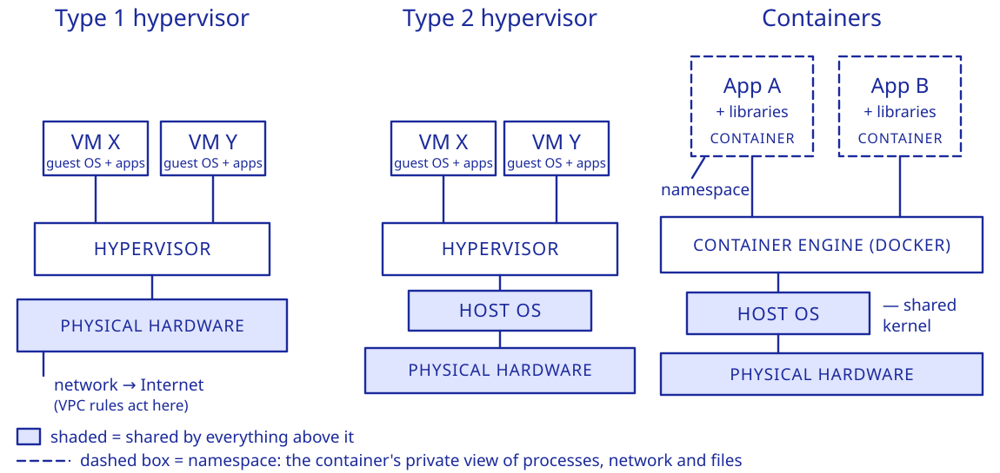

# CS5224 Cloud Computing — Exam Notes Index

Exam: 03/11/26 | 90 min | Open book, no internet, no AI | 25 Qs (20 MCQ + 5 short answer) | 30 marks total | Search: open `CS5224-ALL-COMBINED.pdf` → Cmd+F

---

## Quick Reference — All Lectures

★ = a misconception I held in testing (a wrong mental model, or the same mistake twice), not a slip or an omission.

Look-alike concepts are compared side by side in a small table, numbered in sequence with the rows around it. "See also L03-10" means lecture 3, row or table 10.

### How the pieces fit together (L01-L10)

You choose **who may use** the infrastructure (deployment model) and **how much you manage** (service model). The provider runs it in a **datacenter**, shares machines between customers (virtualisation) and software between tenants (multitenancy), and follows changing load with **scaling architectures**. You build your **app** in a cloud-friendly style, and build the infrastructure itself **from code** (IaC) so it can be recreated identically. L01 says why to move and what can go wrong; L02 says who does which job; L10 says what it costs.

| Layer (top = closest to you) | Question it answers | Building blocks | Lecture |
|---|---|---|---|
| Why and the risks | Should we move, and what can go wrong? | benefits, CapEx to OpEx, trust boundary, lock-in, data residency | L01 |
| Cost | What will it cost, and should we own or rent? | pricing models (on-demand, reserved, Savings Plan, spot), metered usage, business costs (Capex, Opex, sunk, integration, lock-in), datacenter TCO | L10 |
| Roles | Who does which job? | consumer, provider, broker, carrier, auditor | L02 |
| Deployment model | Who may use it, and where may the data live? | public, private, hybrid, community (NIST's four), plus sovereign cloud | L02 |
| Service model | How much do I manage myself? | IaaS, then PaaS, then SaaS: you manage less at each step. **FaaS:** a serverless variant, close to PaaS (you supply only the functions) | L02, L06 |
| App style | How is my software built for the cloud? | stateless 3-tier web app with REST; MapReduce or Spark for big data; functions chained by events | L06 |
| Building the infrastructure | How do we create and change it repeatably? | Infrastructure as Code: declarative code (Terraform, Pulumi, provider tools), modules, one state file per environment; servers as identical, replaceable cattle | L09 |
| Worked examples | How do the pieces combine in a real app? | k-means: S3 + EMR; video app: load balancer + auto-scaled upload servers, S3, SQS queue, auto-scaled encoders, CloudFront | L07 |
| Scaling architectures | How does it follow demand and survive failures? | capacity planning, vertical vs horizontal scaling; load balancing, pooling, dynamic scaling, auto-scaling listener, elastic resource capacity, cloud bursting | L01, L03 |
| Sharing resources | How do many customers share one machine or one app? | VMs (hypervisor) and containers share a machine; multitenancy shares one app instance. See also L05-13 | L05 |
| Datacenter | Where does it physically run? | racks, storage, network, cooling, PUE; latency vs bandwidth | L04 |

### L01 — Principles of Cloud Computing

#### What cloud is and why

| # | Key concept |
|---|-------------|
| 1 | **What cloud is:** IT resources delivered as a service over a network (usually the Internet): on demand, elastic, from a shared pool, metered. You use the service; the provider owns and runs the datacenters. |
| 2 | **Cloud-based IT resource vs cloud service ★:** a cloud-based resource is anything hosted in the cloud; a cloud service is only what is made remotely accessible to consumers. E.g., a database server in AWS that only your own web app talks to is a cloud-based resource; the website it powers, which customers reach, is the cloud service. |
| 3 | **Benefits:** better availability and elasticity, and often lower cost. The catch is concentration risk: when a major provider fails, many services fail together. |
| 4 | **Cost model:** cloud turns a large up-front cost (CapEx) into pay-for-use (OpEx), so it lowers investment risk but is **not necessarily cheaper**. Running costs and migration and integration costs still count. E.g., renting a car per trip instead of buying one: no big payment up front, but if you drive every day, renting can cost more. See also L10-4. |

#### Capacity and scaling

| # | Key concept |
|---|-------------|
| 5 | **Capacity planning:** match capacity to demand, and avoid both under-provisioning (outage, lost sales) and over-provisioning (paying for idle capacity). The three strategies are compared below. |

**5 · Lead vs Lag vs Match**

| | Lead | Lag | Match |
|--|--|--|--|
| Adds capacity | ahead of expected demand | only once the resource is full | in small steps as demand grows |
| Cost | paying for capacity that sits idle until demand arrives, or never comes (over-provisioning) | demand goes unmet at the ceiling (under-provisioning) | demand must be tracked continuously, and the small steps can fall behind a sharp spike |
| Pick it when | an outage costs more than idle capacity | idle capacity costs more than missed demand | demand grows steadily and can be watched |
| Think of it as | a restaurant hiring extra staff before the holiday rush | hiring only once customers queue out the door | adding one waiter at a time as bookings grow |

| # | Key concept |
|---|-------------|
| 6 | **Organisational agility:** how quickly a business responds to change; elastic resources let it follow demand it did not plan for. E.g., a shop whose sales spike after a post goes viral adds servers that day instead of waiting weeks for new hardware. |
| 7 | **Elasticity vs scaling ★:** scaling is the ability to resize and can be manual; elasticity is resizing that rapidly follows demand, out and back in (usually automatic: NIST says "in some cases automatically"). E.g., scaling: you add a server when you decide to; elasticity: the system adds one itself when traffic jumps at 2 a.m. and removes it when traffic drops. See also L02-2 (rapid elasticity), L03-1. |

**8 · Vertical vs horizontal scaling** ★ (see also L03-9, which adds relocation)

| | Vertical (scale up) | Horizontal (scale out) |
|--|--|--|
| How | make the one machine bigger (more CPU, memory) | add more commodity machines |
| Limit | a hard ceiling: the biggest machine available | no single-machine ceiling |
| Cost | specialised hardware, more expensive | cheap commodity hardware |
| Availability (uptime) | still one machine, so it adds capacity but not availability: if it fails, the service is down | if one machine fails, the others keep serving |
| How fast new resources are ready | normally instant | instant |
| Think of it as | upgrading your one truck (bigger engine, bigger cargo bed) | more delivery trucks |

#### Risks and limits

| # | Key concept |
|---|-------------|
| 9 | **Trust boundaries ★:** a trust boundary surrounds the systems and parties you trust. Moving to the cloud widens the **consumer's** boundary to take in the provider, because the consumer's data now sits on the provider's machines. The provider's boundary does not widen: it guards against its customers rather than trusting them. Because the hardware is shared, the consumer's boundary also overlaps with other customers (co-tenants), so the new danger is **a malicious co-tenant** on the same platform. Security responsibility becomes shared between consumer and provider. E.g., moving into a shared house: you now trust the landlord (provider) with your belongings, and your housemates (co-tenants) are already inside the walls, so the *new* danger is a housemate. |
| 10 | **Reduced governance:** you control less of the IT than on-premise, and an unreliable provider may fail to meet its SLA guarantees. Your contract is your main lever, and even a provider that meets a weak contract can leave you with a poor service. E.g., a contract promising 99% uptime lets the provider be down more than 3.5 days a year (1% of 365 days) without breaking it. |

**11 · Latency vs bandwidth** ★ (data transfer is limited by both; adding servers in the same place fixes neither) (see also L04-2 to L04-4)

| | Latency | Bandwidth |
|--|--|--|
| What it is | delay, caused mainly by distance | link capacity (data per second) |
| Fix | move the service closer to users | a bigger link, or send less data |
| Think of it as | the length of the road | the number of lanes |

| # | Key concept |
|---|-------------|
| 12 | **Vendor lock-in ★:** deep use of one provider's proprietary services makes leaving very costly. Reduce it with portable technology, meaning technology that runs largely unchanged on other providers, such as containers (Docker), standard SQL and open data formats. E.g., years of notes in an app that exports only in its own format: the more you use it, the harder it is to leave. See also L02-13 (portability). |
| 13 | **Cloud repatriation:** moving workloads back on-premise can pay off for stable, predictable workloads, but weigh variable demand and lost elasticity, the cost of moving large data back, how deeply the system is tied to the provider, and whether on-premise can match the promised availability. |
| 14 | **Data residency and multi-regional compliance:** law decides where data may be stored, and data kept in several countries falls under each country's own laws. Residency is where data may sit; disclosure is when authorities can demand it. E.g., a hospital keeping patient records in Singapore settles residency, but Singapore authorities can still demand them by law (disclosure), and a backup copy in Japan falls under Japan's laws too. Across several countries: keep each country's data in its own region and route users to that region's service. See also L02-17 (sovereign cloud). |

---

### L02 — Concepts and Models (NIST)

#### Definition and characteristics

| # | Key concept |
|---|-------------|
| 1 | **NIST 5/4/3:** NIST defines **five** essential characteristics, **four** deployment models and **three** service models (SaaS, PaaS, IaaS). DBaaS, FaaS and similar are **variants** of those three, not extra models. |

**2 · The five essential characteristics** ★ (see also L01-7 for elasticity, L05-12 and L10-3 for metered usage)

| Characteristic | What it means | Fails it if | E.g. |
|--|--|--|--|
| **On-demand self-service** | you provision it yourself, with no human at the provider (usually a portal) | you must email or raise a ticket with the provider's staff | clicking "launch server" and having it in minutes |
| **Rapid elasticity** | capacity scales out *and in* with demand | capacity stays fixed until someone upgrades it | a ticket site that grows for a concert sale and shrinks after |
| **Measured service** | usage is metered and you pay per use | a flat fee whatever you use | an electricity meter |
| **Resource pooling** | the provider's resources serve many consumers, and the exact location is hidden | you are tied to one known physical machine | you pick a region, never the physical server |
| **Broad network access** | reachable over the network from many kinds of device | it works only from one office terminal | Gmail on a phone, a laptop and a tablet |

| # | Key concept |
|---|-------------|
| 3 | **Multi-tenancy ★:** one instance serving many tenants. It lowers cost through pooling and better use of resources, at the price of weaker isolation and overlapping trust boundaries; **single tenancy** gives each consumer a separate instance. E.g., hotel rooms versus your own detached house: the hotel is cheaper because everything is shared, but you are closer to the other guests. See also L05-10 (multitenancy vs virtualisation). |

#### Service models

**4 · On-premise vs IaaS vs PaaS vs SaaS** (the consumer always keeps its data)

| | On-premise | IaaS | PaaS | SaaS |
|--|--|--|--|--|
| You manage | everything, down to the hardware | database, integration, runtime, application, data (the provider manages the OS) | application and data | data only |
| Pick it when | you need full control | you install everything above the OS yourself (e.g., Apache, MySQL and PHP installed on the provider's Linux image) | the provider supplies the runtime, database or platform and you deploy your code | you only use a finished application |
| Gain | highest flexibility | scalability, no hardware to buy | the database, frameworks and middleware are ready to use | shortest time-to-market |
| Cost | long time-to-market | privacy concerns | vendor lock-in risk | lowest flexibility |
| Think of it as | building your own house | renting an empty flat: you furnish it | renting a furnished flat: you bring your belongings | staying in a hotel: you bring only your luggage |

| # | Key concept |
|---|-------------|
| 5 | **Managed database ★:** A managed database service (for example AWS RDS with MySQL) is **PaaS** (database-as-a-service), not IaaS and not SaaS. |
| 6 | **Variants and serverless:** Single-capability variants (Storage-, Database-, Function-, Security-as-a-Service and so on) are named for the capability they provide. **Serverless** (Function-as-a-Service) does not mean no server: the provider provisions and manages the servers, so the consumer has none to look after. E.g., taking a taxi instead of owning a car: the car still exists, you just never maintain it. |
| 7 | **Combining models:** A SaaS can be built on PaaS, which runs on IaaS; a provider can host its platform in the consumer's region to meet a legal data-location rule. Stacking service models is **not** hybrid cloud. |

#### Reference architecture: who does what

| # | Key concept |
|---|-------------|
| 8 | **Reference model purpose:** It describes **what** cloud services provide, not how to build them; it is vendor independent and is not the architecture of any specific cloud. |

**9 · The five actors**

| Actor | Role | Think of it as |
|--|--|--|
| **Consumer** | uses the services | the shopper |
| **Provider** | offers the services | the shop |
| **Auditor** | independent review through objective evidence (security, privacy, performance) | an external accountant checking the books |
| **Broker** | bundles and negotiates services (see table 10) | a travel agent |
| **Carrier** | provides connectivity and transport, so a slow path between a healthy provider and its consumer is the carrier's problem | the road the delivery van drives on |

**10 · Broker services**

| | Intermediation | Aggregation | Arbitrage |
|--|--|--|--|
| What it does | adds value on top of **one** service (e.g., single sign-on or reporting) | merges **several** services into one new one, with secure data movement | **chooses** among several providers, without merging them |
| Think of it as (travel agent) | adding insurance to your flight booking | a package holiday: flight, hotel and car in one | finding the cheapest airline each time you fly |

| # | Key concept |
|---|-------------|
| 11 | **Provider internals:** Service orchestration has three layers: the Service Layer; the Resource Abstraction and Control Layer, where virtualisation sits; and the Physical Resource Layer (hardware and facility). Cloud service management is a separate box next to it. |
| 12 | **Service management ★:** **Business Support** holds billing and pricing; **Provisioning/Configuration** holds rapid provisioning, metering and SLA management; **Portability/Interoperability** holds data and system portability. Metering measures usage; billing charges for it. E.g., the electricity meter reading is metering (Provisioning/Configuration); the bill worked out from it is billing (Business Support). |
| 13 | **Portability vs interoperability:** **Portability** is moving your data or system to another provider; **interoperability** is services from different providers working together. E.g., portability: keeping your phone number when you switch carrier; interoperability: calling a friend who uses a different carrier. |
| 14 | **Security and privacy:** Security is **cross-cutting**: it spans all layers and concerns all actors, and is not its own layer. Privacy concerns personal information (PI and PII) held by providers. |

#### Deployment models

**15 · Deployment models** (see also L03-11: cloud bursting is one way to use a hybrid cloud)

| Model | Gain | Cost | E.g. |
|--|--|--|--|
| **Public** | low upfront cost, the provider maintains it | less control | a startup running its app on AWS |
| **Private** | control of sensitive data | usually needs a large in-house IT team | a bank's own cloud for customer records |
| **Community** | shared regulation and cost among similar organisations | needs governance among the members | several hospitals sharing one cloud built for health-data rules |
| **Hybrid** | two or more distinct clouds (e.g., private + public) connected to balance control and cost; not **multi-cloud**, which is several public providers | integration effort | sensitive data on a private cloud, the application on a public one |

| # | Key concept |
|---|-------------|
| 16 | **Private forms:** A private cloud can be on-site or **out-sourced**: dedicated resources hosted by a third party, or a **VPC**, a secure isolated environment inside a public cloud (its VMs may still share physical servers with other customers, kept apart by the hypervisor). Whether out-sourcing weakens security is an open question to evaluate. |
| 17 | **Sovereign cloud ★:** A sovereign cloud keeps data **and metadata** inside national borders and prevents foreign access under all circumstances; neither a private cloud nor an in-country region guarantees that on its own. See also L01-14 (residency vs disclosure). |

---

### L03 — Cloud Architectures

#### Goals and the six architectures

| # | Key concept |
|---|-------------|
| 1 | **Elasticity ★:** it must cope with two kinds of fluctuation: the consumer's own demand (the number of jobs, and demand within each job) and the **available cloud resources**, because the provider is shared and other tenants can take capacity you expected. See also L01-7 (elasticity vs scaling). |
| 2 | **Two objectives ★:** **elasticity** makes capacity follow one consumer's demand; **balanced utilisation** is spreading load over the shared resources so none is over- or under-used. E.g., a hospital: elasticity is one ward getting more beds as its patients increase; balanced utilisation is the hospital spreading all its patients so no ward overflows while another sits empty. |
| 3 | **Six architectures:** two work at the **application level** and spread requests over copies: workload distribution and service load balancing. Three work at the **resource level**: resource pooling groups resources by type, dynamic scalability draws resources from those pools when preset conditions are met, and elastic resource capacity resizes one virtual server. The sixth, **cloud bursting** (row 11), sends on-premise overflow to the cloud. Horizontal, vertical and relocation scaling (table 9) are ways to resize, not architectures. |

#### Load balancing

**4 · Workload distribution vs service load balancing** (both application level; in both, if one copy fails, traffic simply goes to the others, so no standby copy is needed)

| | Workload distribution | Service load balancing |
|--|--|--|
| What it is | the general pattern | a specialised variation of workload distribution, for cloud services |
| What is copied | identical IT resources (e.g. servers), with copies added as load grows (horizontal scaling) | duplicate deployments of **one cloud service**, kept in a resource pool |
| Where the balancer sits | a load balancer in front spreads the requests, so no copy is overloaded while another idles | **independent:** a separate component receives every request first (a receptionist sending each customer to a free counter); **built-in:** the request lands on one service instance, whose own logic forwards some to the others (the first counter's clerk passing customers on to colleagues) |

**5 · AWS load balancers** (all route only to healthy targets)

| Balancer | Works at | Pick it when | E.g. |
|--|--|--|--|
| **Application (ALB)** | the request level (HTTP/HTTPS) | routing depends on the request's content, such as URL path or host name | send `/api` to the API servers and `/images` to the image servers |
| **Network (NLB)** | the connection level (TCP/UDP); does not look inside requests | you need very high throughput and low latency | a game server handling huge numbers of fast connections |
| **Gateway** | the packet (network) level, sitting in the traffic path | traffic must pass through third-party virtual appliances such as firewalls and inspection tools | every packet goes through a firewall before reaching the servers |
| **Classic** | request or connection level (older generation) | backward compatibility; AWS does not recommend it for new designs | an old application not yet moved |

#### Pooling and scaling

| # | Key concept |
|---|-------------|
| 6 | **Resource pooling architecture:** identical resources grouped by type (server, CPU, memory, storage, network) and kept synchronised, to serve diverse consumers. See also L02-2: NIST's resource pooling characteristic is the consumer's view of the same sharing. |

**7 · Pool arrangements** ★ (arrangements inside the pooling architecture, not the architecture itself)

| | Dedicated | Sibling | Nested |
|--|--|--|--|
| Structure | a full set of sub-pools (CPU, memory, storage, network); drawback: it grows complex, ending up with many pools for one consumer | co-located pools from the same datacenter, isolated from each other | one larger pool split into smaller pools of the **same** type |
| For | one consumer or application | different consumers, each kept to its own pool | departments or groups in one organisation |
| Think of it as | a firm renting its own whole set of rooms (desks, storage, meeting rooms) | separate flats side by side in one building | one company's floor divided into department areas of the same desks |

**8 · Dynamic scalability vs elastic resource capacity** (both resource level; both draw the extra resources from the pools)

| | Dynamic scalability | Elastic resource capacity |
|--|--|--|
| What it resizes | the service, most often by adding or removing **whole instances** (any of the three methods in table 9) | **one virtual server**, grown **vertically** in place (more CPU or memory) |
| When it acts | when **predefined conditions** are met (e.g. CPU above a threshold) | **before** the server reaches its threshold |
| Chain | automated scaling listener → new instances drawn from the pools | listener → intelligent automation engine runs a script → hypervisor allocates more CPU and memory to that server from the pools |

**9 · Horizontal vs vertical vs relocation** (the three dynamic scaling methods) (see also L01-8 for why vertical adds no availability)

| | Horizontal | Vertical | Relocation |
|--|--|--|--|
| How | add copies of the resource | grow the one resource in place | move it to a bigger host |
| Pick it when | the service is stateless, so any copy can serve a request | the current host still has spare room | the host itself is the limit |
| Think of it as | more delivery trucks | upgrading the same truck in place | moving the cargo onto a bigger truck |

| # | Key concept |
|---|-------------|
| 10 | **Automated scaling listener:** it monitors load, decides under the scaling policy and triggers replication; the load balancer only routes. No listener means no scaling events even with a policy and free capacity. Separate scale-out and scale-in thresholds plus time windows stop capacity oscillating around a single threshold. E.g., add an instance above 80% CPU for 5 minutes, remove one below 30% for 10 minutes, so a load hovering at 75% changes nothing. |

#### Hybrid: cloud bursting

| # | Key concept |
|---|-------------|
| 11 | **Cloud bursting:** once on-premise load crosses a threshold, the overflow is sent to **pre-deployed, idle** cloud copies (burst out), and they are released when load falls again (burst in). It needs an **automated scaling listener** to trigger the burst, and **resource replication** must keep the state databases synchronised on both sides. E.g., a shop with an overflow tent set up in advance and opened only on sale days; both tills must show the same stock. |

---

### L04 — Resource Hosting and Datacenter

#### Hosting and network speed

| # | Key concept |
|---|-------------|
| 1 | **On-premise vs cloud hosting ★:** on-premise, you run the network connection yourself and fully control its quality of service (QoS). In the cloud, traffic crosses **several carriers' networks**, so QoS depends on them, and cloud hosting suits applications that can tolerate some variation in bandwidth and latency. The cloud is not inherently less secure; there are simply more parties involved. |
| 2 | **Latency vs bandwidth in practice:** bandwidth is easier to increase, because latency is a **physical property** (mostly distance). Each step further out, from memory to disk to the network to a distant site, is much slower, by up to orders of magnitude. How long a transfer takes depends on **server location, latency, bandwidth and the amount of data**, never the amount alone. **If big transfers are slow, add bandwidth; if every small action is slow, the problem is distance.** See also L01-11. |
| 3 | **Slow response with idle servers:** if CPU, memory and the first link are fine, the delay is network distance across carriers; a **CDN** fixes it by keeping versions of the content closer to the consumers. |
| 4 | **Many small remote reads:** the network delay is paid once per read (trips x latency), so **neither a faster CPU nor more bandwidth helps**; make the reads local (cache nearby, closer datacenter, or run the code next to its data). E.g., phoning a friend overseas 100 times to ask one word each time: most of the time goes on waiting for each call to connect, and a line that carries more words per second does not shorten that wait; keep a copy of the answers beside you. |

#### Inside the datacenter

| # | Key concept |
|---|-------------|
| 5 | **Racks of commodity servers:** the datacenter grows by replicating identical racks of cheap commodity servers, the building-scale form of horizontal scaling (L01-8). Each rack's own switch links its servers, so keeping one workload's servers within a rack cuts latency. |
| 6 | **Private vs shared storage ★:** per-task scratch data stays in local DRAM or disk; state that every worker must read and update lives in a **distributed storage network** (shared, more capacity, slower). Storage gets slower the further away it is: within one server, then within the rack, then across racks; a server's own DRAM is fastest. E.g., a group project: your rough notes stay on your own laptop; the document everyone edits lives in Google Docs, slower to reach but the same for everyone. |

#### Power, cooling and reliability

| # | Key concept |
|---|-------------|
| 7 | **Heat and cooling:** almost all consumed energy becomes heat; water removes heat about 1000x better than air but **water usage is very high**, so newer designs use seawater or are built at sea. |
| 8 | **PUE:** total datacenter power ÷ IT equipment power; the ideal is 1. Only cutting the **overhead** (cooling, power distribution) moves it toward 1; cutting IT power while overhead stays the same makes PUE **worse**. Servers use the most electricity, then cooling; storage and network are the smallest. E.g., a PUE of 1.5 means every 1 W the IT equipment uses costs another 0.5 W in cooling and power losses. |
| 9 | **Energy proportionality:** real systems use about **50% of peak power when idle**, so a lightly used fleet is costly; an energy-proportional system uses almost no power idle, little under light load, and more gradually as load rises. E.g., an office that keeps all its lights and air-con on overnight for one late worker: the cost barely falls when the work does. |

**10 · Datacenter tiers** (availability and cost both rise from Tier 1 to Tier 4; Tier 3 is the usual choice, Tier 4 is often overkill)

| | Tier 1 | Tier 2 | Tier 3 | Tier 4 |
|--|--|--|--|--|
| Design | single path for power and cooling, no redundant components | partial redundancy for power and cooling | multiple paths, each with redundant components; **concurrently maintainable** | redundancy for every component |
| Uptime | 99.671% | 99.741% | 99.982% | 99.995% |
| Downtime per year | about 28.8 h | about 22.7 h | about 1.6 h | about 26 min |

---

### L05 — Virtualisation and Multitenancy

#### What virtualisation is

| # | Key concept |
|---|-------------|
| 1 | **Why virtualise:** one physical infrastructure serves many workloads (1:1 becomes many:1), raising utilisation; new VMs are created from **virtual disk images**, so scaling is rapid. Think of one plot of land divided into separate houses: each household has its own home while sharing the plot. |
| 2 | **Hypervisor (VMM) and its costs:** the **hypervisor** (also called the **VMM**, virtual machine manager) is the software layer between the VMs and the physical hardware: it creates and runs the VMs, runs each one's guest OS, and divides the real CPU, memory, storage and network among them. The costs: every access passes through this virtualisation layer (**performance overhead**), and the virtualisation software is a **single point of failure** for all its VMs. |
| 3 | **Four virtualised resources:** processor, memory, storage and network are each pooled and handed to VMs as virtual slices (vCPUs, Vmem, VDisks, vNICs/vSwitches/vFirewalls), so what a VM sees is decoupled from the parts underneath; e.g., if the pool keeps redundant copies, a failed physical drive can be swapped without the VM's virtual disk changing. This is a separate question from how VMs run (full, para or hardware-assisted, table 4). |

#### How VMs run

**4 · Full vs para vs hardware-assisted virtualisation** (three ways to handle the guest OS's privileged requests)

| | Full | Para | Hardware-assisted |
|--|--|--|--|
| Guest OS | **unmodified and unaware** | **modified and aware** | unmodified |
| How requests are handled | the VMM (ring 0) mimics the hardware and **binary-translates** privileged instructions | the guest replaces OS requests with **hypercalls** to the hypervisor: no translation, no special hardware | CPU **virtualisation extensions** make requests **trap** to the hypervisor (root privilege; the guest OS shares the non-root level with user applications) |
| Gain | best isolation, mixed OSs, the guest can later run on bare hardware | no translation overhead | neither translation nor guest modification |
| Cost | translation overhead (reduced performance); the hardware may lack drivers for the virtualisation software | the guest's kernel must be modified, so the guest **cannot run on physical hardware** and is **hard to migrate to other hosts** | needs a CPU with virtualisation extensions |
| Think of it as | an interpreter who steps in only for restricted requests, while ordinary speech passes straight through; the speaker never knows | the speaker is trained to address restricted requests straight to the organiser (the hypervisor), so no interpreter is needed | the room itself routes every restricted request to the organiser: no interpreter, and the speaker changes nothing |

**5 · Type 1 vs Type 2 hypervisor** (*where* the hypervisor sits; table 4 is *how* requests reach the hardware, and any pairing is possible; the guest OS does not decide the type)

| | Type 1 (bare metal) | Type 2 (hosted) |
|--|--|--|
| Runs on | the hardware directly: the hypervisor boots in place of an OS, so there is no host OS | a **host OS** that keeps running normal apps and that the hypervisor uses to reach the hardware |
| Used in | datacenters | laptops (e.g., VirtualBox running Windows inside macOS) |
| If attacked | no host OS to attack | a compromised **host OS** sits below the hypervisor and can compromise it and every guest |

| # | Key concept |
|---|-------------|
| 6 | **Guest OS attack:** a compromised **guest OS** stays isolated and the hypervisor is not compromised (applies to either type). |

#### Containers

**7 · VM vs container** ★

| | VM | Container |
|--|--|--|
| What it has | its own guest OS, on a hypervisor | **no guest OS and no hypervisor**: an isolated user space (via namespaces) that **shares the host's kernel** (the OS core that manages CPU, memory and devices) |
| How it isolates | the hypervisor gives each VM **virtual hardware** (only the hardware is shared) | **namespaces**: the kernel gives each container its own view of processes, network and files (the kernel is shared) |
| Weight | heavy, slower to start | light, starts fast |
| Can run | different OSs | only software for the host's kernel (no Windows app on a Linux host) |
| Isolation | separate VMs: stronger | the shared kernel is a weaker boundary |
| Think of it as | a house with its own foundations and plumbing | a flat sharing the building's plumbing |

| # | Key concept |
|---|-------------|
| 8 | **Docker run ★:** **client** (the `docker` command you type) → sends the request over a REST API → **daemon** (the background service that does the work) → looks for the **image** locally → **pulls it from a registry** (Docker Hub by default) only if missing → creates and starts a **container**, a runnable instance of the image. The client only passes the request on. E.g., a restaurant: the waiter (client) only passes your order to the kitchen (daemon); the kitchen cooks the dish (container) from its recipe (image), fetching the recipe from the recipe library (registry) only if it does not already have it. |
| 9 | **Images vs containers:** an image is a **read-only template** (often based on another image, or built from a Dockerfile); changes made inside a container go into its own writable layer, never the image, and are lost when the container is removed. Rebuilding or `docker commit` makes a **new** image, often under the same name. E.g., an image is a recipe and a container a dish cooked from it: adding salt to your plate does not change the recipe. |

#### Multitenancy

**10 · Virtualisation vs multitenancy** ★ (multitenancy is built on virtualisation) (see also L02-3)

| | Virtualisation | Multitenancy |
|--|--|--|
| What is shared | the **hardware** | **one software instance** |
| What each user sees | its own VM | its own dedicated view of the application, while the provider runs one shared instance |
| E.g. | VirtualBox or a cloud host running many VMs | Dropbox, email (e.g., Gmail) |
| Think of it as | separate houses built on one plot of land | one hotel run by one staff, where every guest has a private room |

| # | Key concept |
|---|-------------|
| 11 | **Telling them apart:** a customer given its own app copy in a VM is single-tenant at the software level, yet may still share the physical host with other customers' VMs. |
| 12 | **Isolation inside multitenancy:** one shared instance must still keep each tenant's load, data, backup and restore, and bill separate (billed per feature or plan); if tenants share one database, restoring one tenant without touching the others is hard. See also L02-2 (measured service), L10-2 (SaaS pricing). |

#### Putting it together

| # | Key concept |
|---|-------------|
| 13 | **Service models:** all rest on a virtualisation layer; **IaaS** hands infrastructure architects **VMs**, **PaaS** hands developers runtimes and databases via **Docker** containers, **SaaS** hands application consumers a seat in a **multitenant** application. See also L02-4 (who manages what). |

**14 · The stacks side by side** (one server shared by VMs; Type 1 and Type 2 hypervisors; containers on a shared host OS)

---

### L06 — Applications and Paradigms

#### What suits the cloud, and how web apps talk

| # | Key concept |
|---|-------------|
| 1 | **Good and poor fits:** the cloud suits work that splits into many **independent tasks** (web services, search, ML on large models). It fits poorly when steps depend on each other in sequence (A → B → C) or instances talk to each other constantly, because the network's bandwidth and latency then set the pace. See also L01-11. |
| 2 | **Performance isolation:** sharing brings performance isolation problems: shared VMs and multitenant services slow down when overall utilisation is high, even for CPU-only work with no network traffic (unlike latency/bandwidth fluctuations, which need data crossing the network). |
| 3 | **Statelessness ★:** a stateless server keeps nothing between requests. Each request carries what it needs (e.g. the page number or a token), and anything that must persist lives in a shared **external store** (database or cache). Then **a load balancer can send any request to any copy**; per-user state kept in one server's memory breaks once there are several copies. **REST** is built on stateless servers, caching and language-independent HTTP with JSON or XML; **SOAP** is the heavier XML message protocol. E.g., any waiter can serve your table because your order is written on the ticket, not kept in one waiter's head. See also L03-4. |
| 4 | **Three tiers:** presentation (the user interface, on **both** client and server side), application (logic), data (persistent stores). |

#### Choosing a service model

**5 · SaaS vs PaaS vs IaaS for one goal** (the same data-analytics app built three ways; see also L02-4)

| | SaaS | PaaS | IaaS |
|--|--|--|--|
| Consumer does | gives the app its data, reads the report | builds its own pipeline on a ready stack | creates a Linux instance, installs and configures the stack, then builds the pipeline |
| Consumer controls | only its data | its software's deployment and configuration | everything installed above the OS (versions, settings) |
| Provider handles | the whole app | installing and maintaining libraries and middleware; scaling | the physical infrastructure and the OS (offers preconfigured VMs) |
| Pick it when | no programmers, results needed fast | developers want to code but not run the stack | a specific software version is needed, or lift-and-shift |

#### Big data: MapReduce, Hadoop, Spark

| # | Key concept |
|---|-------------|
| 6 | **A MapReduce run ★:** the programmer writes only **map** and **reduce**; the system does every other step. Map emits a pair for **every occurrence** → the system splits each map's output by key into one partition per reducer, kept on the mapper's **local disk** → once **all** maps have finished, each reducer fetches its partition from every mapper (shuffle), then merges and sorts it → reduce adds up the values for each key → final results go to shared storage. So a word seen twice gives (cloud,1) twice, never (cloud,2): adding up is reduce's job. E.g., an election count: each polling station writes one slip per ballot ("A, 1"), the slips are sorted into one pile per candidate, and one clerk per candidate adds up a pile. |
| 7 | **Performance:** the master runs each map task where its data already is (**data locality**, less network traffic), and workers switch between mapper and reducer. More workers help only up to an **optimum**: past it, the master is swamped coordinating, and shuffle traffic explodes because every reducer fetches from every mapper; tiny splits add per-task overhead. |

**8 · Hadoop MapReduce vs Spark** (Hadoop stack: **YARN** schedules resources, **MapReduce** computes, **HDFS** stores)

| | Hadoop MapReduce | Spark |
|--|--|--|
| Works | on disk between phases | in memory |
| Processing | batch only | batch (faster) and real-time |
| Machine learning | needs external tools | built in (MLlib) |
| Pick it when | large nightly batch jobs | results needed within seconds, or machine learning; can run **on top of** an existing Hadoop cluster and read its HDFS data |

#### FaaS (serverless functions)

| # | Key concept |
|---|-------------|
| 9 | **When FaaS fits:** a function runs only when an event triggers it: **no idle capacity**, you pay only while code runs, it scales itself with no capacity planning, and the provider maintains it (like PaaS; containers or VMs you run yourself need the most upkeep). It fits spiky, event-triggered, short tasks. It fits poorly with steady 24/7 load, holding connections or state, and long heavy jobs (FaaS has resource limits; use a VM or container). See also L02-6. |
| 10 | **Asynchronous offloading ★:** when a request does slow follow-up work before replying (receipt, PDF, analytics), reply as soon as the essential step is done, publish an event, and let background functions do the rest. The user stops waiting because **nothing waits on that work**, not because the function is fast. E.g., a restaurant hands you a buzzer at once instead of keeping you at the counter while your meal is cooked. |
| 11 | **Building with functions ★:** each function does one action, is self-contained and uses few libraries. Functions **never call each other** and are not merged into one: chain them by **events** (a function saves its output, and that save triggers the next function). Keep state in an **external store** (see L06-3). |

---

### L07 — Example Applications

#### K-means on MapReduce

| # | Key concept |
|---|-------------|
| 1 | **K-means as a MapReduce job ★:** one job is one round. **Map** labels each point: it measures the distance to every current centroid and emits **one (clusterID, point) pair per point**, keyed by the nearest centroid (N points in, N pairs out, only k distinct keys). It never emits a centroid or a count. **Reduce** receives every point of one cluster and averages them into the new centroid, output as (clusterID, centroid, number of points). Reducers cannot feed mappers within a job, so the next round is a **new job** that gives the new centroids to every mapper, repeated until the centroids stop moving. See also L06-6. |
| 2 | **Preparing and reading the data:** k-means uses only distance, so the attribute with the widest range dominates, and a few extreme values pull a centroid out to themselves, wasting one of the k clusters. Take **log** values first: large values are compressed and equal ratios become equal distances. Reading log2 centroids: a difference of d means 2^d times (8 → 256x). K-means always forms k clusters; choosing k is the open problem. |
| 3 | **Running it on AWS:** data, code and results live in **S3**; the computation runs on **EMR** (managed MapReduce: the provider runs the framework, you bring data and map/reduce code), a cluster started per run and shut down after. Cluster disks vanish at shutdown, so S3 keeps everything between rounds and runs, and compute is paid only while the job runs. The trade-off is reading over the network instead of local disks (see also L06-7). |

#### Video-sharing app: upload, encode, stream

| # | Key concept |
|---|-------------|
| 4 | **Split stages by bottleneck:** upload and streaming are **I/O-intensive**, encoding (converting uploads to a streamable format) is **CPU-intensive**. Upload (web) servers and encoders run as **separate auto-scaling groups**, each sized and scaled for its own demand, so a burst of heavy encoding only delays conversion and never makes uploads time out. |
| 5 | **Hand-off through a queue:** the upload server (behind a load balancer) saves the raw video to an S3 bucket → puts a short message in **SQS** (a pointer to the file, not the video) → replies to the user at once → a free encoder polls SQS and takes the message → downloads the raw file, encodes it and stores the result in a second S3 bucket → only then **deletes the message**. A taken message is only hidden, not deleted: if the encoder dies mid-job, it reappears and another encoder takes it, so **no job is lost**. Encoders scale on the **queue backlog**, down to zero when it is empty. E.g., a kitchen ticket rail: the waiter clips the order and returns to customers, any free cook takes it, and it is thrown away only when the dish is served. See also L06-10, L03-10. |
| 6 | **Streaming through a CDN:** CloudFront edge locations keep copies of what nearby viewers request. First view near an edge: a **miss**, the edge fetches from S3 (the origin), streams it and keeps a copy; later nearby views are **hits** served locally. Far-away viewers stop buffering and a viral video no longer floods the single bucket (it sends about one copy per edge); rarely watched videos keep missing. See also L04-2. |

#### Service models and pricing

**7 · Service model of each video-app component** (set by what the consumer gets and manages, not by who built it or the hardware under it; one app can be PaaS-built for the team and SaaS for viewers) (see also L02-4)

| | IaaS | PaaS | SaaS |
|--|--|--|--|
| What you get | a machine or resource you run your own software on | a ready-made building block your code calls | finished software you just use |
| In the video app | EC2, S3, load balancer, auto-scaling | SQS; the video encoder (an internal component developers build with) | CloudFront, the media player, the whole app for viewers |

| # | Key concept |
|---|-------------|
| 8 | **Pricing the app:** cost items are EC2, S3 storage, CloudFront delivery and PaaS usage. Compute follows work done (50 one-minute encodes a day = 50 busy minutes, so scale to zero instead of running 24/7); delivery follows GB streamed; storage follows **everything kept so far**, so it grows every month with flat traffic unless old or raw files are deleted. Cost comparisons come in three kinds: **traditional** (cloud vs on-premise), **inter-cloud** (between providers) and **intra-cloud** (between one provider's offerings, such as instance types, or on-demand vs spot). See also L10-1, L10-3. |

---

### L09 — Infrastructure as Code

#### Why IaC and how it works

| # | Key concept |
|---|-------------|
| 1 | **Why IaC:** managing infrastructure by hand (clicking in the console, or one-off command-line commands) is slow, error-prone and hard to scale, and it drifts: fixes are made in one environment and never written down, so environments end up different and nothing records what is really running. With **Infrastructure as Code**, the wanted infrastructure is written as code, every environment is **built by running that same code** (only settings such as size differ), and changes are made only by editing the code and applying it again. So the environments **match because they are built from the same code**, the code describes what should be running, and Terraform's plan shows any difference from it. Because it is code, it gets version control, review, testing and CI/CD, and a production-like test environment can be created on demand and deleted afterwards. |

**2 · Imperative vs declarative**

| | Imperative (task management) | Declarative (state management) |
|--|--|--|
| You write | the exact steps, in order | the end state you want, e.g. "5 VMs behind 1 load balancer" |
| How it runs | replays the steps blindly; you must know the current state to write the right steps | reads what exists, compares it with the file, and makes **only the difference** |
| Run it again | repeats the steps, creating duplicates or failing (less idempotent) | finds nothing to change (idempotent) |
| Starting point and drift | works only from the state it was written for; never notices changes made by hand | any starting point works; a resource deleted by hand is recreated |
| Change the target (3 to 5 VMs) | write new steps for the current state | edit one number |
| Coding skill needed | more | less |
| Cost | hard to maintain, more human error | less control (the tool picks the order); overkill for a tiny task |
| Pick it when | a small one-off task where you want control over each step | anything repeated, shared or long-lived |
| Think of it as | turn-by-turn directions, useless if you start somewhere else | telling a taxi driver only the destination |

**3 · Pets vs cattle** ★ (IaC makes servers cattle; it does not detect failures) (see also L03-9, L03-10)

| | Pets | Cattle |
|--|--|--|
| What it is | one named server, hand-tuned over time | identical servers built from the same code, any one replaceable by another |
| When one fails | someone repairs it by hand | it is thrown away and a fresh copy is built from the code |
| Who does what | a person does everything | **IaC** defines the server, so a copy is identical and ready in minutes. The **load balancer's health check** stops sending traffic to the dead server, and **auto-scaling** launches the replacement |
| Cost | one server | with one server that is replaced automatically, you pay for one but have a few minutes of downtime while the copy starts; with several running, you pay more but have no downtime |
| Pick it when | it cannot be rebuilt from a definition (a one-of-a-kind legacy server) | anything in the cloud; IaC is built for this model |

#### Choosing a tool

**4 · IaC tools**

| | Cloud provider tools | Terraform | Pulumi |
|--|--|--|--|
| What | AWS CloudFormation (templates) and CDK (code in a programming language that generates CloudFormation templates); Azure Resource Manager; Google Infrastructure Manager (deploys Terraform configurations onto Google Cloud) | an independent tool with its own declarative language | an independent tool where you write the infrastructure in TypeScript, Python, Go or C# |
| Clouds | only that provider's | many: any platform with an API, through **providers** (plugins, thousands of them in the Terraform Registry, that turn the configuration into each platform's API calls) | many |
| Approach | CDK and Pulumi are written in an ordinary programming language, but the result is still **declarative**: CDK produces a CloudFormation template of the end state, and Pulumi, like Terraform, compares the wanted state with its own state file and makes only the difference | declarative | declarative (see the first column) |
| Pick it when | you use one cloud and want its native service | several clouds, plain declarative configuration | several clouds, and complex logic (loops, conditions) in a language the team already knows |

#### Terraform in practice

**5 · Configuration, state file, plan and apply** ★ (configuration + state file → plan → apply → updated state file)

| Part | What it is | Changes the cloud? |
|--|--|--|
| **Configuration** (`.tf` files) | what you want, written by you | no |
| **State file** | Terraform's own record of which real resource (by its ID) belongs to each item in the configuration, written and used only by Terraform. It is how Terraform tells its own resources from everything else in the account, and how it knows to destroy a resource you remove from the configuration. It **does not update itself** when someone changes the cloud by hand | no |
| **Plan** | looks up every resource in the state in the real cloud, compares them with the configuration and lists the changes needed | no, it only lists them |
| **Apply** | does the same comparison, asks for "yes", makes the changes and updates the state | **yes** |

| # | Key concept |
|---|-------------|
| 5 | **What follows:** a tracked VM deleted by hand is noticed and recreated, because plan looks it up by its ID and finds it gone; a resource created by hand is not in the state, so Terraform never sees it. Terraform also works out which resources depend on which and creates the independent ones in parallel. |
| 6 | **Several environments (dev, staging, production):** write the infrastructure once as a **module** with inputs (server count, size, backups on or off). Each environment is its own folder that uses the module with its own values and has its **own state file**. One module means the environments' code cannot diverge and one fix reaches all of them; separate state files mean a plan or apply in dev can only touch dev. Something only one environment needs is either a module input that switches it on or an extra resource in that environment's folder. Copying the whole folder per environment lets the copies diverge; one shared state file puts production into every run. |

#### Drift, security and the future

| # | Key concept |
|---|-------------|
| 7 | **Drift after IaC ★:** IaC reduces drift but does not end it, because people can still change the live system by hand (e.g. an emergency fix in the console). **Detect it** by running `terraform plan` automatically on a schedule (e.g. nightly in the CI/CD pipeline) and alerting the team whenever it lists a change. The **next apply undoes a hand change to any resource Terraform tracks**, because apply always makes a fresh plan, and that plan sets the resource back to what the code says. The plan does list the reversal, but if the person typing "yes" (or a pipeline that approves automatically) does not read it, a forgotten 2 a.m. fix is silently undone, perhaps during an apply meant for something unrelated. A resource created by hand is not in the state, so apply leaves it alone. So every emergency change goes back into the code (or is undone) through normal review. |
| 8 | **Security, and where IaC is heading:** a mistake in the code is copied into every environment built from it, so the code needs continuous checking; access keys stored in the code leak with it; and drift can break compliance standards. Coming next: **Policy-as-Code** checks every change against rules automatically in the pipeline. **GitOps** deploys whatever is merged into Git automatically, with nobody applying by hand. **Self-healing IaC** monitors the system, analyses it against baselines and predictions, then plans and carries out a fix; this goes beyond auto-scaling, which only adds or replaces servers by a fixed rule (see also L03-10). |

---

### L10 — Pricing Models and TCO

#### Pricing models

**1 · On-demand vs reserved vs Savings Plan vs spot** (pick by the demand pattern) (see also L01-5)

| | On-demand | Reserved | Savings Plan | Spot |
|--|--|--|--|--|
| How you pay | per use, billed to the second with a **60-second minimum**, from server start to stop | a one-time upfront fee plus a lower hourly rate, for a fixed term (start date to expiry date) | a lower price in exchange for committing to a consistent amount of usage over a longer term; more flexible than reserved | a bid for the provider's unused capacity, well below the on-demand rate |
| Cost | the highest hourly rate, but nothing is paid when nothing runs | every hour of the term is **paid whether used or not**, so it only saves money on servers that run nearly all the time | same as reserved: the commitment is paid even in quiet months | the capacity can be taken back at short notice, so the job stops |
| Pick it when | demand is spiky or unpredictable (extra servers for a viral spike) | demand is steady 24/7 for a long time (the always-on base servers) | the same steady demand, when you want flexibility; an alternative to reserved, not added on top | the job can be interrupted and delayed (a nightly batch that resumes) |
| Think of it as | paying for each gym visit | a yearly gym membership: cheaper per visit, paid even if you never go | a membership valid at any branch | a standby flight ticket: cheap, but you can be bumped |

#### What a bill is made of

**2 · SaaS integrated vs separate pricing** (see also L05-12)

| | Integrated | Separate |
|--|--|--|
| Who pays whom | the consumer pays the SaaS provider, which pays the IaaS provider for hosting | the consumer pays the SaaS provider for the software **and** the IaaS provider for the hosting |
| The consumer's bill follows | what SaaS is priced on: modules subscribed, named users, transactions | the SaaS price plus what IaaS is priced on: number of servers, data transferred, storage allocated |
| A usage surge with the same users | the consumer's bill does not change; the SaaS provider pays the bigger hosting bill | the consumer's hosting bill rises |
| Cost | one predictable price, which includes the SaaS provider's markup and margin for heavy months | an unpredictable bill and a second contract to manage, but you pay actual usage and can see the hosting cost |
| Think of it as | a caterer who rents the venue and sends you one bill | paying the caterer and the venue yourself |

| # | Key concept |
|---|-------------|
| 3 | **What is metered, and tiers:** **network:** outbound traffic, including replication or synchronisation to another cloud (inter-cloud); inbound and traffic inside one cloud (intra-cloud) are often free. **Server:** on-demand from start to stop, reserved from start date to expiry. **Storage:** GB allocated × the time it stays allocated, plus I/O transfers at some providers. **Service:** subscription length, number of users, number of transactions. Tiered rates are charged **band by band, like tax brackets**: passing a threshold makes only the usage above it cheaper. See also L07-8. |

#### Cloud or not: business costs

| # | Key concept |
|---|-------------|
| 4 | **Capex, Opex and the cost of capital:** business cost = up-front cost (Capex: buying, deploying and administering the resources; high on-premise, low in the cloud) + ongoing cost (Opex: licences, electricity, maintenance; higher on-premise). The **cost of capital** is the cost of borrowing the money for the Capex, so when it is high, leasing cloud resources is justified. See also L01-4. |

**5 · Sunk vs integration vs lock-in costs** (each makes the cloud less appealing) (see also L01-12)

| | Sunk cost | Integration cost | Lock-in cost |
|--|--|--|--|
| What it is | money already spent on IT resources you still have | the effort to make your systems work on the new platform | the cost of moving from one cloud provider to another |
| Why it argues against the cloud | the hardware is paid for and still usable, so moving now means paying cloud bills while it sits idle | it adds a big one-off cost to the move | it makes a later change of provider expensive |
| High when | the servers were bought recently | custom or old systems tied to local hardware (barcode scanners, a mainframe) | the app relies on one provider's own services |
| Low when | the servers are old or failing | off-the-shelf software | portable technology (containers, standard interfaces) |

#### Owning a datacenter: TCO

| # | Key concept |
|---|-------------|
| 6 | **What the TCO of owning hardware is made of:** datacenter depreciation + datacenter Opex (the building and what keeps the hardware working) + server depreciation + server Opex. Capex (building, servers) is depreciated over a set time frame; Opex is the recurring cost (electricity, repairs, salaries). With **high-end servers**, server depreciation is about two thirds of TCO. With **cheaper servers that use more power**, the server share falls to about a third, so power and the building take bigger shares. Each pie chart shows shares of **its own total**, so convert to dollars before comparing, and compare designs by total cost for the same work, never by slice size. |
| 7 | **Low utilisation:** the building's yearly depreciation is fixed once it is built, used or not. At **50% utilisation**, the server and power costs halve but the building cost does not, so the building's cost per running server **doubles** and its share of TCO grows, while the server-linked shares shrink. E.g., paying rent on a four-room flat but using only two rooms: the rent stays the same and the cost per used room doubles. |

---

## Exam Tactics

- **Design questions** ("design a cloud solution for…"): go down the checklist below in order and skip the questions the scenario does not raise. For each one it does raise, write "**X, because** <the requirement in the scenario>", and name the trade-off you accept. Finish with three checks: every requirement in the scenario has a choice; scaling also goes **back down**; no two choices clash (e.g. a private cloud alone cannot absorb a spike, so add cloud bursting to a public cloud).

| Ask | Cues in the scenario | Pick by |
|---|---|---|
| 1 · Where may the data live? | patient or financial data, a law, government use, several countries | sensitive data → private or hybrid (sensitive part private) several organisations under the same rules → community several countries → each country's data in its own region, users routed to it foreign access must be impossible, even to metadata → sovereign cloud |
| 2 · How much do we manage? | new app, legacy app, small team, short tasks triggered by events | an existing app does the job → SaaS building a new app → PaaS you need specific software versions, or are moving an existing app over unchanged (lift-and-shift) → IaaS short, spiky, event-triggered tasks → FaaS (not steady 24/7, stateful or long heavy jobs) |
| 3 · How does it follow demand? | spikes, deadlines, growth, unpredictable load | unpredictable spikes → horizontal + auto-scaling behind a load balancer, with scale-in rules a private cloud handles the normal load → send the overflow to a public cloud (cloud bursting) scale vertically only while the one machine still has room to grow stages with different bottlenecks (I/O upload, CPU encoding) → separate groups, each scaling on its own demand |
| 4 · Must the user wait? | slow response because several steps run before the reply, queues at peak | reply once the essential step is done, and run receipts, emails and analytics in the background slow heavy jobs (encoding) → queue + workers that delete a message only when done (no lost jobs), scaled on the backlog |
| 5 · How does it survive failures? | must stay up, outages are costly | must stay up → copies across zones, with a load balancer that sends traffic only to healthy copies (failover) worth it when an outage costs more than the idle copies |
| 6 · Where are the users? | users far away, slow responses, big transfers | every small action is slow → move the service closer to users, because latency comes from distance big transfers are slow → more bandwidth many far-away users fetching the same content (videos, images) → CDN |
| 7 · Who else shares it? | other cloud customers, tenants of your SaaS | other cloud customers on the same server → rely on hypervisor isolation, plus a VPC to keep the network separate your own app's tenants → keep each tenant's data, load and billing separate |
| 8 · Can we leave later? | avoid lock-in, may switch provider | may need to switch provider → portable technology (containers), standard interfaces, more than one provider worth it when switching later would cost more than the convenience of proprietary services |
| 9 · How heavy is the data processing? | terabytes of logs, nightly reports, results within seconds, machine learning | large batch jobs where waiting hours is fine (a nightly report) → Hadoop MapReduce results needed within seconds (real-time, e.g. live fraud alerts) or machine learning → Spark, because it keeps data in memory instead of on disk (runs on its own or on an existing Hadoop cluster) |
| 10 · How do we build and change it repeatably? | dev, staging and production; several regions or clouds; setup done by hand; environments that behave differently; changes made in the console | infrastructure you rebuild or copy → IaC several clouds → Terraform or Pulumi one cloud → its own tool several environments → one shared module, with a separate state file per environment to catch drift → run `plan` on a schedule and alert on any change |
| 11 · What will it cost? | steady 24/7 load, spikes, batch jobs that can wait, tight budget, servers bought recently, expensive borrowing | steady base → reserved or Savings Plan unpredictable extra → on-demand jobs that can be interrupted and delayed → spot choosing an instance → the family that fits the job's bottleneck, compared by cost per unit of work recent hardware or hard-to-move custom systems → wait short of cash or borrowing is expensive → cloud |
