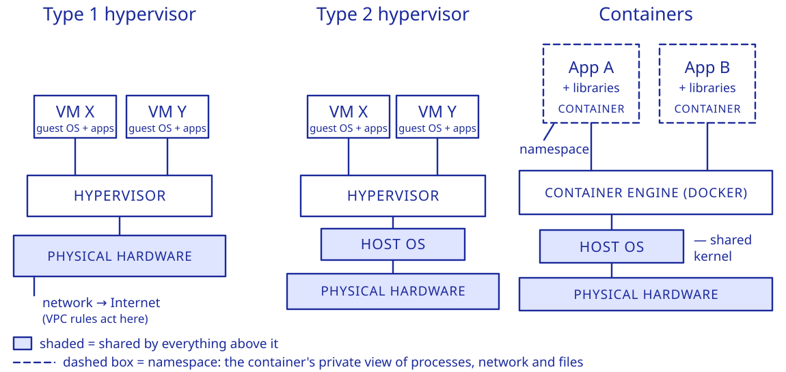

# Cloud Computing: Key Concepts Reference

Built from the CS5224 lectures, the NIST definition of cloud computing (SP 800-145) and common industry practice. Rows marked *(beyond the course)* are industry practice the course does not teach. It keeps the concepts you would actually use or explain in practice, not every slide.

Look-alike concepts are compared side by side in a small table, numbered in sequence with the rows around it. "See also T3-9" means section 3, row or table 9.

---

## Key Concepts

### How the pieces fit together

You choose **who may use** the infrastructure (deployment model) and **how much you manage** (service model). The provider runs it in a datacenter, shares machines between customers (virtualisation) and software between tenants (multitenancy), and follows changing load with scaling and failure design. You build your app in a cloud-friendly style, and build the infrastructure itself **from code** so it can be recreated identically. Cost, performance and risk cut across all of it.

| Layer | Question it answers | Building blocks | Section |
|---|---|---|---|
| Foundations | What is cloud, and who manages what? | five characteristics, service models, deployment models, shared responsibility | T1 |
| Compute and isolation | How do customers safely share machines and apps? | VMs and hypervisors, containers, serverless, multitenancy | T2 |
| Scaling and availability | How does it follow demand and survive failures? | vertical vs horizontal scaling, load balancing, auto-scaling, queues, redundancy, SLAs, disaster recovery | T3 |
| Performance and networking | Why is it slow, and how do I speed it up? | latency vs bandwidth, caching, CDN, datacenter basics, observability | T4 |
| Data and application style | How is software built for the cloud? | stateless apps, MapReduce and Spark, worked examples | T5 |
| Infrastructure as Code | How do we create and change it repeatably? | declarative code, Terraform, state, drift | T6 |
| Cost | What will it cost, and own or rent? | pricing models, cost levers, TCO | T7 |
| Security, compliance and risk | What can go wrong, and where may data live? | trust boundary, residency, sovereignty, lock-in | T8 |
| Design checklist | How do I approach a design problem? | one row per requirement type | T9 |

---

### T1 — Foundations (from L01, L02)

| # | Key concept |
|---|-------------|
| 1 | **What cloud is:** IT resources delivered as a service over a network (usually the Internet): on demand, elastic, from a shared pool and metered. The provider owns and runs the datacenters; you use the service. **Benefit:** better availability and elasticity, and often lower cost. **Watch out:** concentration risk. When a major provider fails, many services fail together. |

**2 · The five essential characteristics** (NIST) (see also T3-3 for elasticity, T7-4 for metered usage)

| Characteristic | What it means | Fails it if | E.g. |
|--|--|--|--|
| **On-demand self-service** | you provision it yourself, with no human at the provider (usually a portal) | you must email or raise a ticket with the provider's staff | clicking "launch server" and having it in minutes |
| **Rapid elasticity** | capacity scales out *and in* with demand | capacity stays fixed until someone upgrades it | a ticket site that grows for a concert sale and shrinks after |
| **Measured service** | usage is metered and you pay per use | a flat fee whatever you use | an electricity meter |
| **Resource pooling** | the provider's resources serve many consumers, and the exact location is hidden | you are tied to one known physical machine | you pick a region, never the physical server |
| **Broad network access** | reachable over the network from many kinds of device | it works only from one office terminal | Gmail on a phone, a laptop and a tablet |

**3 · On-premise vs IaaS vs PaaS vs SaaS** (the consumer always keeps its data; the course slide shows the OS as provider-managed on IaaS, but NIST and industry practice put it with you) (see also T1-8)

| | On-premise | IaaS | PaaS | SaaS |
|--|--|--|--|--|
| You manage | everything, down to the hardware | the OS, database, integration, runtime, application, data (the provider manages the hardware and virtualisation) | application and data | data only |
| Pick it when | you need full control | you want control of the OS and everything above it, or move an existing app over unchanged (lift-and-shift) | the provider supplies the runtime, database or platform and you deploy your code | you only use a finished application |
| Gain | highest flexibility | scalability, no hardware to buy | the database, frameworks and middleware are ready to use | shortest time-to-market |
| Cost | long time-to-market | more to run yourself (OS patching, scaling, security setup) | vendor lock-in risk | lowest flexibility |
| Think of it as | building your own house | renting an empty flat: you furnish it | renting a furnished flat: you bring your belongings | staying in a hotel: you bring only your luggage |

| # | Key concept |
|---|-------------|
| 4 | **Variants and serverless:** NIST defines **five** characteristics, **four** deployment models and **three** service models (SaaS, PaaS, IaaS). Storage-, Database- and Function-as-a-Service are **variants** of these, named for the capability they give; a managed database such as AWS RDS is PaaS. **Serverless** does not mean no server: the provider provisions and manages the servers, so you have none to look after (a taxi: the car exists, you never maintain it). Stacking models (a SaaS built on PaaS on IaaS) is **not** hybrid cloud. |
| 5 | **The five actors:** the **consumer** uses the service, the **provider** offers it, the **auditor** independently reviews security, privacy and performance, and the **carrier** supplies the connectivity (a slow path between a healthy provider and its consumer is the carrier's problem). The **broker** bundles services in three ways: **intermediation** adds value to one service (single sign-on), **aggregation** merges several into one new service, and **arbitrage** picks among several providers (the cheapest storage at each upload). |

**6 · Deployment models**

| Model | Gain | Cost | E.g. |
|--|--|--|--|
| **Public** | low upfront cost, the provider maintains it | less control | a startup running its app on AWS |
| **Private** | control of sensitive data | usually needs a large in-house IT team | a bank's own cloud for customer records |
| **Community** | shared regulation and cost among similar organisations | needs governance among the members | several hospitals sharing one cloud built for health-data rules |
| **Hybrid** | two or more distinct clouds (e.g., private + public) connected to balance control and cost; not **multi-cloud**, which is several public providers | integration effort | sensitive data on a private cloud, the application on a public one |

| # | Key concept |
|---|-------------|
| 7 | **Private forms:** a private cloud can be on-site or **out-sourced**: dedicated resources hosted by a third party, or a **VPC**, an isolated environment inside a public cloud. A VPC's VMs may still share physical servers with other customers, kept apart by the hypervisor (T2-2). |
| 8 | **Shared responsibility model** *(beyond the course)*: the provider secures the cloud itself (facilities, hardware, hypervisor, the internals of managed services); you secure what you put in it: your data, who can access it, and your configuration. **Shifts with the service model:** the further toward SaaS, the more the provider covers (you patch the OS on IaaS, not on PaaS or SaaS), but **data and access are always yours**. **Watch out:** customer-side misconfiguration, such as a publicly readable storage bucket or an over-broad permission, is a leading cause of cloud breaches. See also T1-3, T8-1. |

---

### T2 — Compute and isolation (from L05, L06)

| # | Key concept |
|---|-------------|
| 1 | **Virtualisation and the hypervisor:** virtualisation lets one physical machine run many workloads (raising utilisation), each in a VM created from a virtual disk image, so new capacity is quick. The **hypervisor** (VMM) sits between the VMs and the hardware: it creates the VMs, runs each guest OS, and divides the real CPU, memory, storage and network among them as virtual slices. **Cost:** every access passes through it (overhead), and it is a single point of failure for its VMs. Think of one plot of land divided into separate houses. |
| 2 | **Who isolates VMs:** the **hypervisor** gives each VM its own share and stops it touching another's, so a compromised VM stays contained. A VPC only controls **network traffic** between machines; it cannot stop one VM reading another's memory on the same server, because that never crosses the network. Escapes from a VM into the hypervisor are rare but have happened, so the hypervisor is a high-value target to keep patched. |

**3 · Type 1 vs Type 2 hypervisor** (*where* the hypervisor sits; the guest OS does not decide the type)

| | Type 1 (bare metal) | Type 2 (hosted) |
|--|--|--|
| Runs on | the hardware directly: the hypervisor boots in place of an OS, so there is no host OS | a **host OS** that keeps running normal apps and that the hypervisor uses to reach the hardware |
| Used in | datacenters | laptops (e.g., VirtualBox running Windows inside macOS) |
| If attacked | no host OS to attack | a compromised **host OS** sits below the hypervisor and can compromise it and every guest |
| If a guest is compromised | the guest stays isolated and the hypervisor is not compromised (either type) | same |

**4 · Full vs para vs hardware-assisted virtualisation** (three ways to handle the guest OS's privileged requests, meaning the instructions that touch the machine itself; ordinary instructions run straight on the CPU)

| | Full | Para | Hardware-assisted |
|--|--|--|--|
| Guest OS | **unmodified and unaware** | **modified and aware** | unmodified |
| Privileged requests | the hypervisor **translates** them in software | the guest makes **hypercalls** straight to the hypervisor | CPU **virtualisation extensions** trap each one and hand it to the hypervisor |
| Trade-off | any guest runs unchanged, but translation costs speed | fast, but the guest must be modified and cannot run on bare hardware | fast and unmodified, but needs a CPU with the extensions (modern CPUs have them, so this is the usual choice) |

**5 · VM vs container** (see also T2-12)

| | VM | Container |
|--|--|--|
| What it has | its own guest OS, on a hypervisor | **no guest OS and no hypervisor**: an isolated user space that **shares the host's kernel** (the OS core that manages CPU, memory and devices) |
| How it isolates | the hypervisor gives each VM **virtual hardware** (only the hardware is shared) | **namespaces**: the kernel gives each container its own view of processes, network and files (the kernel is shared) |
| Weight | heavy, slower to start | light, starts fast |
| Can run | different OSs | only software built for the host's kernel (another Linux distribution works; a Windows app on a Linux host does not) |
| Isolation | separate VMs: stronger | the shared kernel is a weaker boundary: a kernel flaw can reach every container on the host, while a VM has its own kernel behind the hypervisor |
| Think of it as | a house with its own foundations and plumbing | a flat sharing the building's plumbing |

| # | Key concept |
|---|-------------|
| 6 | **Docker run:** client (the `docker` command you type) → sends the request over a REST API → **daemon** (the background service that does the work) → looks for the **image** locally → **pulls it from a registry** (Docker Hub by default) only if it is missing → creates and starts a **container**. The client only passes the request on. E.g., a restaurant: the waiter (client) passes your order to the kitchen (daemon), which cooks the dish (container) from its recipe (image), fetching the recipe from the recipe library (registry) only if it does not already have it. |
| 7 | **Images vs containers:** an image is a **read-only template** (the app's code, libraries and tools, often built from a Dockerfile); a container is a running instance of it. **Why read-only:** every container starts identical, and many can share one image safely. **Changes** made inside a container go to its own writable layer, not the image, and vanish when the container is removed, so keep data that must survive outside it. Rebuilding the image (or `docker commit`) makes a **new** image. E.g., adding salt to your plate does not change the recipe. |

**8 · Virtualisation vs multitenancy** (multitenancy is built on virtualisation)

| | Virtualisation | Multitenancy |
|--|--|--|
| What is shared | the **hardware** | **one software instance** |
| What each user sees | its own VM | its own dedicated view of the application, while the provider runs one shared instance |
| Who keeps customers apart | the hypervisor | the application's own code |
| E.g. | VirtualBox or a cloud host running many VMs | Dropbox, email (e.g., Gmail) |
| Think of it as | separate houses built on one plot of land | one hotel run by one staff, where every guest has a private room |

| # | Key concept |
|---|-------------|
| 9 | **What "tenancy" means:** ask **"tenant of what?"**: the hardware, the application or the database. **Strict meaning:** one software instance serving many tenants, each with its own data and settings (single tenancy gives each customer its own instance). **Loose meaning:** many customers sharing the same infrastructure. NIST says the provider's resources are pooled "using a multi-tenant model", and vendors sell "single-tenant" dedicated hardware as the opposite. **Telling them apart:** a customer with its own app copy in a VM is single-tenant at the software level, yet may share the physical host with other customers' VMs. |
| 10 | **Isolation inside multitenancy:** a shared app must still keep each tenant's load, data, backup and restore, and bill separate. Three common ways to hold the data: (1) one shared database with a tenant ID on every row: cheapest, but restoring one tenant without touching the rest is hard (2) a schema per tenant: in between (3) a database per tenant: strongest isolation and easiest restore, but the most to run **Watch out:** the separation is only as good as the application's code, and one tenant's heavy use can slow the others (T4-5). |
| 11 | **Serverless functions (FaaS):** a function runs only when an event triggers it. **Use it when** the work is spiky, event-triggered and short: no idle capacity, you pay only while code runs, it scales itself and the provider maintains it. **Poor fit:** steady 24/7 load, held connections or state (a chat service keeping connections open for hours), and long heavy jobs (FaaS has resource limits; use a VM or container). **Building with it:** one action per function. Avoid having functions call each other directly (the caller sits idle and billed while it waits, and a failure ripples back); chain them by **events** (one function saves its output, and that save triggers the next) or use an orchestrator such as AWS Step Functions. Keep state in an external store (T3-6). |

**12 · The stacks side by side** (Type 1 and Type 2 hypervisors; containers on a shared host OS)

---

### T3 — Scaling and availability (from L01, L03, L06, L07)

| # | Key concept |
|---|-------------|
| 1 | **Capacity planning:** match capacity to demand, and avoid both under-provisioning (outage, lost sales) and over-provisioning (paying for idle capacity). The three strategies are compared below. |

**2 · Lead vs Lag vs Match**

| | Lead | Lag | Match |
|--|--|--|--|
| Adds capacity | ahead of expected demand | only once the resource is full | in small steps as demand grows |
| Cost | paying for capacity that sits idle until demand arrives, or never comes (over-provisioning) | demand goes unmet at the ceiling (under-provisioning) | demand must be tracked continuously, and the small steps can fall behind a sharp spike |
| Pick it when | an outage costs more than idle capacity | idle capacity costs more than missed demand | demand grows steadily and can be watched |
| Think of it as | a restaurant hiring extra staff before the holiday rush | hiring only once customers queue out the door | adding one waiter at a time as bookings grow |

| # | Key concept |
|---|-------------|
| 3 | **Elasticity vs scaling:** scaling is the ability to resize and can be manual; elasticity is resizing that rapidly **follows demand**, out and back in, and is usually automatic. Adding servers by hand on a fixed schedule is scaling, not elasticity. E.g., scaling: you add a server when you decide to; elasticity: the system adds one itself when traffic jumps at 2 a.m. and removes it when traffic drops. See also T1-2. |

**4 · Vertical vs horizontal scaling** (a third method, **relocation**, moves the workload to a bigger host when the host itself is the limit)

| | Vertical (scale up) | Horizontal (scale out) |
|--|--|--|
| How | make the one machine bigger (more CPU, memory) | add more commodity machines |
| Limit | a hard ceiling: the biggest machine available | no single-machine ceiling |
| Cost | specialised hardware, more expensive | cheap commodity hardware |
| Availability (uptime) | still one machine, so it adds capacity but not availability: if it fails, the service is down | if one machine fails, the others keep serving |
| Works best for | parts that cannot be split, such as a single large database | stateless servers and read-heavy tiers (a database can add read replicas, extra copies that serve reads, though they may lag slightly behind) |
| Think of it as | upgrading your one truck (bigger engine, bigger cargo bed) | more delivery trucks |

| # | Key concept |
|---|-------------|
| 5 | **Why adding servers can still fail:** (1) **A shared part does not scale:** one database, one network link or the load balancer becomes the bottleneck, so extra servers send more load to the same limit (read replicas help reads, not writes). (2) **Scaling reacts late:** new instances take minutes to start, and the group may hit its maximum or the account's quota, so a sudden spike overwhelms the existing servers first. (3) **One job is too big for one server:** more copies do not make a single heavy request lighter, and work done synchronously keeps a server busy for the whole request (T3-11). |
| 6 | **Statelessness:** a stateless server keeps nothing between requests. Each request carries what it needs (e.g. the page number or a token), and anything that must persist lives in a shared **external store** (database or cache). **Why it matters:** then a load balancer can send any request to any copy. Per-user state kept in one server's memory breaks as soon as there are several copies. **REST** is built on stateless servers, caching and language-independent HTTP with JSON or XML. E.g., any waiter can serve your table because your order is written on the ticket, not kept in one waiter's head. |
| 7 | **Load balancing:** a load balancer spreads requests across copies and sends them only to **healthy** ones (health checks), so if one copy fails the traffic goes to the others. It does not add capacity or replace servers; auto-scaling does (T3-9). It can be **independent** (a separate component receives every request first, like a receptionist) or **built-in** (the request lands on one instance, whose own logic forwards some to the others). |

**8 · AWS load balancers** (all route only to healthy targets)

| Balancer | Works at | Pick it when | E.g. |
|--|--|--|--|
| **Application (ALB)** | the request level (HTTP/HTTPS) | routing depends on the request's content, such as URL path or host name | send `/api` to the API servers and `/images` to the image servers |
| **Network (NLB)** | the connection level (TCP/UDP); does not look inside requests | you need very high throughput and low latency | a game server handling huge numbers of fast connections |
| **Gateway** | the packet (network) level, sitting in the traffic path | traffic must pass through third-party virtual appliances such as firewalls and inspection tools | every packet goes through a firewall before reaching the servers |

| # | Key concept |
|---|-------------|
| 9 | **Auto-scaling:** a **scaling listener** watches the load and, under a scaling policy, adds or removes instances; the load balancer only routes. (Some platforms can also resize one server in place, called vertical autoscaling, but adding and removing instances is the norm.) **Avoid flapping:** use separate scale-out and scale-in thresholds and time windows (cooldowns). E.g., add an instance above 80% CPU for 5 minutes, remove one below 30% for 10, so a load hovering at 75% changes nothing. **Reactive vs scheduled:** reactive scaling starts only after the load has risen, and new instances take time to boot. A **predictable surge** (offices opening at 9 a.m.) calls for **scheduled** scaling that adds capacity beforehand: the lead strategy (T3-2). |
| 10 | **Cloud bursting:** a hybrid-cloud pattern. When on-premise load crosses a threshold, the overflow goes to cloud capacity (burst out), and it is released when the load falls (burst in). In the textbook design the cloud copies are **pre-deployed and idle**, so they are ready at once; starting them on demand costs less but is slower. It needs a listener to trigger it and the state databases kept in sync on both sides. E.g., a shop with an overflow tent set up in advance and opened only on sale days; both tills must show the same stock. |
| 11 | **Queues and asynchronous work:** if a request triggers slow follow-up work (conversion, receipts, email), reply once the essential step is done and let background workers finish it. The user stops waiting because **nothing waits on that work**, not because the work got faster. **How it works:** the web server saves the data (e.g. a raw video to S3) → puts a short message in a queue (SQS: a pointer to the file, not the file) → replies at once → a free worker takes the message → processes it and stores the result → only then **deletes the message**. **No job is lost:** a taken message is only hidden. If the worker dies mid-job it reappears and another worker takes it. **Scaling:** scale workers on the queue backlog (down to zero when empty), and keep stages with different bottlenecks (I/O-heavy upload, CPU-heavy encoding) in **separate groups**, so a burst of heavy work only delays processing and never makes uploads time out. E.g., a kitchen ticket rail: the waiter clips the order and returns to customers, any free cook takes it. See also T5-6. |
| 12 | **Designing for failure:** **Spread:** put copies in several zones (so one datacentre failing does not stop the service) behind a load balancer whose health checks send traffic only to healthy copies, and let auto-scaling replace what fails. **Size for failure:** after the biggest single unit fails, the remaining capacity must still cover demand (for 500 requests per second with 350-capacity servers, two give 350 after a failure: not enough; three give 700: enough). **One provider is still one point of failure:** several zones of one provider do not protect against a provider-wide outage; that needs a second provider (multi-cloud) or a private fallback (hybrid), see T8-5. **Worth it** when an outage costs more than the idle copies. |

**13 · Availability and downtime per year** *(beyond the course)*

| Availability | Downtime per year (about) |
|--|--|
| 99% | 3.65 days |
| 99.9% | 8.8 hours |
| 99.99% | 53 minutes |
| 99.999% | 5 minutes |

| # | Key concept |
|---|-------------|
| 14 | **Combining availability, and what an SLA gives you** *(beyond the course)*: **Required components multiply:** a service needing two components, each 99.9% available, is about 99.8% available, so more dependencies lower the total. **Redundant copies raise it:** two independent copies that are each 99% available give about 99.99% (assuming their failures are independent and failover is instant, which is the ideal). **SLA:** the provider's written availability promise. The remedy for missing it is typically a **service credit**, not compensation for lost business, so build your own redundancy instead of relying on the SLA. See also T8-2. |

**15 · Disaster recovery strategies** *(beyond the course)* (**RPO**: how much recent data you can afford to lose; **RTO**: how long you can afford to be down)

| | Backup and restore | Pilot light | Warm standby | Multi-site active-active |
|--|--|--|--|--|
| What runs elsewhere | only backups | the core (data kept up to date), other servers off | a scaled-down full copy, always running | full copies in several places, all serving traffic |
| Recovery time | hours | tens of minutes | minutes | close to zero |
| Cost | lowest | low | medium | highest |
| Pick it when | the system can be down for hours | the core must come back fast, the rest can wait | recovery must be quick but full capacity can follow | any outage is very costly |

---

### T4 — Performance and networking (from L01, L04, L06, L07)

**1 · Latency vs bandwidth** (data transfer is limited by both; adding servers in the same place fixes neither)

| | Latency | Bandwidth |
|--|--|--|
| What it is | delay, caused mainly by distance | link capacity (data per second) |
| Fix | move the service closer to users | a bigger link, or send less data |
| Think of it as | the length of the road | the number of lanes |

| # | Key concept |
|---|-------------|
| 2 | **Transfer time and quality of service:** how long a transfer takes depends on **server location, latency, bandwidth and the amount of data**, never the amount alone (a small backup over a slow, distant link can take longer than a large one over a fast, close link). **Bandwidth is easier to buy than latency**, because latency is a physical property (mostly distance). **On-premise vs cloud:** on-premise you run the network connection and control its quality of service; in the cloud, traffic crosses several carriers' networks, so quality depends on them. |

**3 · Where the time goes** (a quick diagnosis: is it the network or the servers?)

| Clue | Likely cause | Fix |
|--|--|--|
| big transfers or slow data access, CPU fine | bandwidth | more bandwidth, or send less data |
| every small action slow, users far away, CPU low | latency (distance), and many small remote reads each pay the delay | move the service closer, CDN, cache nearby; neither a faster CPU nor more bandwidth helps |
| servers busy, slow queries, the same content fetched again and again | too much work per request | caching, faster database queries, CDN |
| spikes, deadlines, growth | more requests than capacity | load balancing, auto-scaling, bursting (T3) |
| the user waits while non-essential steps run before the reply | steps done in the wrong order | reply after the essential step, do the rest asynchronously (T3-11) |
| VMs on one host competing for CPU, memory or disk | contention | optimise the allocation of resources between VMs |
| a CPU-heavy job on I/O-oriented servers, or the reverse | the wrong kind of resource | match the instance type to the bottleneck |

| # | Key concept |
|---|-------------|
| 4 | **Caching and CDNs:** a **cache** stores answers so repeat requests skip the slow part; a **CDN** is a cache at edge locations near viewers. **CDN flow:** the first view near an edge is a **miss** (the edge fetches from the origin, streams it and keeps a copy); later nearby views are **hits**, served locally. So far-away viewers stop buffering, the origin is not flooded, and rarely watched content keeps missing. **Rules:** cache only data that may be slightly old (a product description, not a checkout balance). Every hit saves one database query, so the database's load is the **misses**, and adding application servers does not fix a database limit (T3-5). |
| 5 | **Noisy neighbours (performance isolation):** sharing has a cost. Shared VMs and multitenant services slow down when overall utilisation is high, even for CPU-only work with no network traffic. Isolating each tenant's load keeps one customer from slowing the rest. |
| 6 | **Datacenter basics:** **PUE** = total power ÷ IT equipment power; the ideal is 1. It moves toward 1 as the **overhead** (cooling, power distribution) shrinks relative to the IT load; cutting IT power while overhead stays the same makes PUE **worse**. E.g., a PUE of 1.5 means every 1 W of IT use costs another 0.5 W in cooling and losses. **Power use:** servers draw the most, then cooling. A lightly used fleet still draws about 50% of peak power, so it is costly. **Tiers** trade cost for uptime: Tier 1 (single path, about 28.8 hours of downtime a year) to Tier 4 (full redundancy, about 26 minutes). Tier 3 is the usual choice. |
| 7 | **Observability** *(beyond the course)*: **metrics** (numbers over time such as CPU, latency and error rate), **logs** (records of events) and **traces** (the path of one request across services) show why a system is slow or failing. Alert on what users feel (error rate, latency), not only on resource use, and feed the same metrics to auto-scaling. |

---

### T5 — Data and application style (from L06, L07)

| # | Key concept |
|---|-------------|
| 1 | **Good and poor fits:** the cloud suits work that splits into many **independent tasks** (web services, search, machine learning on large models). It fits poorly when steps depend on each other in sequence (A → B → C) or instances talk to each other constantly, because the network's bandwidth and latency then set the pace. A typical web app has three tiers: presentation (the user interface), application (logic) and data (persistent stores). See also T4-2, T3-6. |
| 2 | **A MapReduce run:** the programmer writes only **map** and **reduce**; the system does every other step. **Steps:** map emits a pair for **every occurrence** → the system splits each map's output by key into one partition per reducer, on the mapper's **local disk** → once **all** maps have finished, each reducer fetches its partition from every mapper (shuffle), then merges and sorts it → reduce adds up the values for each key → results go to shared storage. So without a combiner, a word seen twice gives (cloud,1) twice, never (cloud,2): adding up is reduce's job (an optional **combiner** can pre-add on the map side to cut shuffle traffic). E.g., an election count: each polling station writes one slip per ballot, the slips are sorted into one pile per candidate, and one clerk per candidate adds up a pile. |
| 3 | **MapReduce performance:** the master runs each map task where its data already is (**data locality**, less network traffic). More workers help only up to an **optimum**: past it, the master is swamped coordinating, and shuffle traffic explodes because every reducer fetches from every mapper. Tiny splits add per-task overhead. |

**4 · Hadoop MapReduce vs Spark** (Hadoop stack: **YARN** schedules resources, **MapReduce** computes, **HDFS** stores; in practice Spark has largely taken over from MapReduce for new work)

| | Hadoop MapReduce | Spark |
|--|--|--|
| Works | on disk between phases | in memory |
| Processing | batch only | batch (faster) and real-time |
| Machine learning | needs external tools | built in (MLlib) |
| Pick it when | large nightly batch jobs | results needed within seconds, or machine learning; can run **on top of** an existing Hadoop cluster and read its HDFS data |

| # | Key concept |
|---|-------------|
| 5 | **Worked example, k-means on MapReduce:** one job is one round. **Map** labels each point with its nearest centroid: one (clusterID, point) pair per point. **Reduce** averages each cluster's points into the new centroid. The next round is a **new job** with the new centroids, repeated until they stop moving. **Prepare the data:** k-means uses only distance, so extreme values dominate and waste a cluster. Take **log** values first (in log2, a difference of d means 2^d times). **Run it:** data, code and results live in S3, and the computation runs on EMR, a managed cluster started per run and shut down after, so you pay only while the job runs. |
| 6 | **Worked example, a video-sharing app:** browser → load balancer → auto-scaled upload web servers → raw video into S3 → message in an SQS queue → auto-scaled encoders (CPU-heavy) → encoded video into a second S3 bucket → CloudFront serves it from edge locations near viewers. **Each piece answers a requirement:** separate groups for different bottlenecks with a queue between them (T3-11), auto-scaling on the queue backlog (T3-9), and a CDN for distant viewers (T4-4). |

---

### T6 — Infrastructure as Code (from L09)

| # | Key concept |
|---|-------------|
| 1 | **Why IaC:** managing infrastructure by hand (clicking in the console, or one-off commands) is slow, error-prone and hard to scale, and it drifts: fixes are made in one environment and never written down, so environments end up different and nothing records what is really running. **With IaC:** the wanted infrastructure is written as code, every environment is **built by running that same code** (only settings such as size differ), and changes are made only by editing the code and applying it again. So the environments match because they come from the same code, and the tool's plan shows any difference from it. **Bonus:** being code, it gets version control, review, testing and CI/CD, and a production-like test environment can be created on demand and deleted afterwards. |

**2 · Imperative vs declarative**

| | Imperative (task management) | Declarative (state management) |
|--|--|--|
| You write | the exact steps, in order | the end state you want, e.g. "5 VMs behind 1 load balancer" |
| How it runs | replays the steps blindly; you must know the current state to write the right steps | reads what exists, compares it with the file, and makes **only the difference** |
| Run it again | repeats the steps, creating duplicates or failing (less idempotent) | finds nothing to change (idempotent) |
| Starting point and drift | works only from the state it was written for; never notices changes made by hand | any starting point works; a resource deleted by hand is recreated |
| Change the target (3 to 5 VMs) | write new steps for the current state | edit one number |
| Cost | hard to maintain, more human error | less control (the tool picks the order); overkill for a tiny task |
| Pick it when | a small one-off task where you want control over each step | anything repeated, shared or long-lived |
| Think of it as | turn-by-turn directions, useless if you start somewhere else | telling a taxi driver only the destination |

**3 · Pets vs cattle** (IaC makes servers cattle; it does not detect failures) (see also T3-12)

| | Pets | Cattle |
|--|--|--|
| What it is | one named server, hand-tuned over time | identical servers built from the same code, any one replaceable by another |
| When one fails | someone repairs it by hand | it is thrown away and a fresh copy is built from the code |
| Who does what | a person does everything | **IaC** defines the server, so a copy is identical and ready in minutes. The **load balancer's health check** stops sending traffic to the dead server, and **auto-scaling** launches the replacement |
| Cost | one server | with one server that is replaced automatically, you pay for one but have a few minutes of downtime while the copy starts; with several running, you pay more but have no downtime |
| Pick it when | it cannot be rebuilt from a definition (a one-of-a-kind legacy server) | anything in the cloud; IaC is built for this model |

**4 · IaC tools**

| | Cloud provider tools | Terraform | Pulumi |
|--|--|--|--|
| What | AWS CloudFormation (templates) and CDK (code in a programming language that generates CloudFormation templates); Azure Resource Manager; Google Infrastructure Manager (deploys Terraform configurations onto Google Cloud) | an independent tool with its own declarative language | an independent tool where you write the infrastructure in TypeScript, Python, Go or C# |
| Clouds | only that provider's | many: any platform with an API, through **providers** (plugins in the Terraform Registry that turn the configuration into each platform's API calls) | many |
| Approach | CDK and Pulumi are written in an ordinary programming language, but the result is still **declarative**: CDK produces a CloudFormation template of the end state, and Pulumi, like Terraform, compares the wanted state with its own state file and makes only the difference | declarative | declarative |
| Pick it when | you use one cloud and want its native service | several clouds, plain declarative configuration | several clouds, and complex logic (loops, conditions) in a language the team already knows |

**5 · Configuration, state file, plan and apply** (configuration + state file → plan → apply → updated state file)

| Part | What it is | Changes the cloud? |
|--|--|--|
| **Configuration** (`.tf` files) | what you want, written by you | no |
| **State file** | Terraform's own record of which real resource (by its ID) belongs to each item in the configuration, written and used only by Terraform. It is how Terraform tells its own resources from everything else in the account, and how it knows to destroy a resource you remove from the configuration. It **does not update itself** when someone changes the cloud by hand | no |
| **Plan** | looks up every resource in the state in the real cloud, compares them with the configuration and lists the changes needed | no, it only lists them |
| **Apply** | does the same comparison, asks for "yes", makes the changes and updates the state | **yes** |

| # | Key concept |
|---|-------------|
| 6 | **What follows:** a tracked VM deleted by hand is noticed and recreated, because plan looks it up by its ID and finds it gone. A resource created by hand is not in the state, so Terraform never sees it. **Why it can be slow:** Terraform works out which resources depend on which and creates the independent ones in parallel, so a chain of needless dependencies forces them to run one after another; and every plan re-reads each tracked resource, so one huge configuration is slow to plan. **Fix:** keep dependencies to what is real, and split large configurations into smaller modules and state files (which also limits the damage of a mistake). |
| 7 | **Several environments (dev, staging, production):** write the infrastructure once as a **module** with inputs (server count, size, backups on or off). Each environment is its own folder that uses the module with its own values and has its **own state file**. **Why:** one module means the environments' code cannot diverge and one fix reaches all of them; separate state files mean a plan or apply in dev can only touch dev. **Avoid:** copying the whole folder per environment lets the copies diverge, and one shared state file puts production into every run. |
| 8 | **Drift after IaC:** people can still change the live system by hand (e.g. an emergency console fix), so it stops matching the code. **Detect it:** run `terraform plan` on a schedule (e.g. nightly in CI/CD) and alert on any change it lists. **What the next apply does:** it undoes the hand change to any resource Terraform tracks, because apply always makes a fresh plan that sets the resource back to what the code says. The plan lists the reversal, but if the approver (or an auto-approving pipeline) does not read it, a forgotten 2 a.m. fix is silently undone. A resource created by hand is not in the state, so apply leaves it alone. **Habit:** every emergency change goes back into the code (or is undone) through normal review. |
| 9 | **Security, and where IaC is heading:** a mistake in the code is copied into every environment built from it, so the code needs continuous checking, and access keys stored in the code leak with it. **Policy-as-Code** checks every change against rules automatically in the pipeline, **GitOps** deploys whatever is merged into Git automatically, and **self-healing IaC** monitors, analyses and then fixes the system itself, going beyond auto-scaling's fixed rules. |

---

### T7 — Cost (from L10, L01, L07)

| # | Key concept |
|---|-------------|
| 1 | **Capex, Opex and the cost of capital:** cloud turns a large up-front cost (Capex: buying, deploying and administering the resources) into pay-for-use (Opex: licences, electricity, maintenance). It lowers investment risk but is **not necessarily cheaper**: running, migration and integration costs still count. The **cost of capital** is the cost of borrowing the money for the Capex, so when it is high, leasing cloud resources is justified. E.g., renting a car per trip instead of buying one: no big payment up front, but if you drive every day, renting can cost more. |

**2 · On-demand vs reserved vs Savings Plan vs spot** (pick by the demand pattern) (see also T3-2)

| | On-demand | Reserved | Savings Plan | Spot |
|--|--|--|--|--|
| How you pay | per use, billed to the second with a **60-second minimum**, from server start to stop | an upfront fee (all, part or none of it) in exchange for a lower hourly rate, for a fixed term (start date to expiry date) | a lower price in exchange for committing to a consistent amount of usage over a longer term; more flexible than reserved | the provider's spare capacity at a steep discount (no bidding needed on AWS today) |
| Cost | the highest hourly rate, but nothing is paid when nothing runs | every hour of the term is **paid whether used or not**, so it only saves money on servers that run nearly all the time | same as reserved: the commitment is paid even in quiet months | the capacity can be taken back at short notice, so the job stops |
| Pick it when | demand is spiky or unpredictable (extra servers for a viral spike) | demand is steady 24/7 for a long time (the always-on base servers) | the same steady demand, when you want flexibility; an alternative to reserved, not added on top | the job can be interrupted and delayed (a nightly batch that resumes) |
| Think of it as | paying for each gym visit | a yearly gym membership: cheaper per visit, paid even if you never go | a membership valid at any branch | a standby flight ticket: cheap, but you can be bumped |

| # | Key concept |
|---|-------------|
| 3 | **Cutting a VM bill without losing availability:** **Baseline vs peaks:** reserved or Savings Plan for the steady baseline; on-demand (added by auto-scaling) only for peaks. **Spot:** only for interruptible work. For important work, mix spot with on-demand and spread spot across several instance types, so one pool being reclaimed does not stop everything. **Waste:** right-size (check CPU and memory use and pick the instance that fits), shut down non-production environments outside working hours, and move static files to object storage behind a CDN. **Don't** scale production down to a single instance: it removes the redundancy availability depends on (T3-12). |
| 4 | **What is metered, and tiers:** **Network:** outbound traffic, including replication or synchronisation to another cloud (inter-cloud); inbound traffic and traffic inside one cloud (intra-cloud) are often free. **Server:** on-demand from start to stop, reserved from start date to expiry. **Storage:** GB allocated × the time it stays allocated (plus I/O transfers at some providers), so it grows with **everything kept so far** and rises every month, even with flat traffic, unless old files are deleted. **Service:** subscription length, number of users, number of transactions. **Tiered rates** are charged **band by band, like tax brackets**: passing a threshold makes only the usage above it cheaper. |
| 5 | **SaaS pricing, integrated vs separate:** **integrated** means you pay the SaaS provider one price that includes hosting: predictable, with the provider's margin for heavy months built in, and a usage surge does not change your bill. **Separate** means you pay the SaaS provider for the software and the IaaS provider for hosting: an unpredictable bill and two contracts, but you pay actual usage and can see the hosting cost, and a surge raises your hosting bill. E.g., a caterer who rents the venue and sends you one bill, versus paying the caterer and the venue yourself. |

**6 · Sunk vs integration vs lock-in costs** (each makes the cloud less appealing)

| | Sunk cost | Integration cost | Lock-in cost |
|--|--|--|--|
| What it is | money already spent on IT resources you still have | the effort to make your systems work on the new platform | the cost of moving from one cloud provider to another |
| Why it argues against the cloud | the hardware is paid for and still usable, so moving now means paying cloud bills while it sits idle | it adds a big one-off cost to the move | it makes a later change of provider expensive |
| High when | the servers were bought recently | custom or old systems tied to local hardware (barcode scanners, a mainframe) | the app relies on one provider's own services |
| Low when | the servers are old or failing | off-the-shelf software | portable technology (containers, standard interfaces) |

| # | Key concept |
|---|-------------|
| 7 | **The cost of owning hardware (TCO):** datacenter depreciation + datacenter Opex (the building and what keeps the hardware working) + server depreciation + server Opex. Compare designs by **total cost for the same work**, never by slice size, because each chart shows shares of its own total. **At low utilisation** the building's depreciation is fixed once it is built, so its cost per running server rises. E.g., paying rent on a four-room flat but using only two rooms: the rent stays the same and the cost per used room doubles. |
| 8 | **Cloud repatriation:** moving workloads back on-premise can pay off for stable, predictable workloads. Weigh variable demand and lost elasticity, the cost of moving large data back, how deeply the system is tied to the provider, and whether on-premise can match the promised availability. |

---

### T8 — Security, compliance and risk (from L01, L02)

| # | Key concept |
|---|-------------|
| 1 | **Trust boundaries:** a trust boundary surrounds the systems and parties you trust. **Consumer:** moving to the cloud widens **your** boundary to take in the provider, because your data now sits on its machines. **Provider:** its boundary does not widen; it guards against its customers rather than trusting them. **Co-tenants:** because the hardware is shared, your boundary also overlaps with other customers, so the new danger is **a malicious co-tenant** on the same platform. Security becomes a shared responsibility (T1-8). E.g., moving into a shared house: you now trust the landlord with your belongings, and your housemates are already inside the walls, so the *new* danger is a housemate. |
| 2 | **Reduced governance and SLAs:** you control less of the IT than on-premise, and an unreliable provider may fail to meet its SLA. Your contract is your main lever, and even a provider that meets a weak contract can leave you with a poor service. E.g., a contract promising 99% uptime lets the provider be down more than 3.5 days a year without breaking it (T3-13). |
| 3 | **Data residency and disclosure:** law decides where data may be stored, and data kept in several countries falls under each country's own laws. **Residency** is where data may sit; **disclosure** is when authorities can demand it. E.g., a hospital keeping patient records in Singapore settles residency, but Singapore authorities can still demand them by law, and a backup copy in Japan falls under Japan's laws too. **Across several countries:** keep each country's data in its own region, route users to that region's service, and add access control, encryption and auditing. |
| 4 | **Sovereign cloud:** aims to keep data **and metadata** inside national borders and under local legal control, with foreign access shut out; neither a private cloud nor an in-country region gives you that on its own. If you only need data to stay in a country, choosing that country's region and replicating only across its zones is the lighter option. |
| 5 | **Vendor lock-in, portability and multi-cloud:** deep use of one provider's proprietary services makes leaving very costly. **Reduce it** with **portable** technology, meaning technology that runs largely unchanged on other providers, such as containers (Docker), standard SQL and open data formats. **Portability** is moving your data or system to another provider; **interoperability** is services from different providers working together (portability: keeping your phone number when you switch carrier; interoperability: calling a friend on a different carrier). **Multi-cloud or hybrid** also protects against a provider-wide outage, whereas several zones of one provider do not. |

---

### T9 — Design checklist

- **Designing a solution** ("design a cloud solution for…"): go down the checklist below in order and skip the questions the scenario does not raise. For each one it does raise, write "**X, because** <the requirement in the scenario>", and name the trade-off you accept. If the scenario leaves out the deciding fact, say so: "it depends on <the fact>: if …, …; if …, …". Finish with three checks: every requirement in the scenario has a choice; scaling also goes **back down**; no two choices clash (e.g. a private cloud has fixed capacity, so a spike beyond it needs either spare capacity you pay for all year or cloud bursting to a public cloud).

| Ask | Cues in the scenario | Pick by |
|---|---|---|
| 1 · Where may the data live? | patient or financial data, a law, government use, several countries | sensitive data → private or hybrid (sensitive part private) nothing says the data is sensitive and the load is steady → public or private both work several organisations under the same rules → community several countries → each country's data in its own region, users routed to it, plus access control, encryption and auditing one country plus high availability → that country's region, with copies only across its zones foreign access must be blocked, even to metadata → sovereign cloud |
| 2 · How much do we manage? | new app, legacy app, small team, short tasks triggered by events | an existing app does the job → SaaS building a new app → PaaS you need specific software versions, or are moving a legacy app over unchanged (lift-and-shift) → IaaS short, spiky, event-triggered tasks → FaaS (not steady 24/7, stateful or long heavy jobs) |
| 3 · How does it follow demand? | spikes, deadlines, growth, unpredictable load | unpredictable spikes → horizontal + auto-scaling behind a load balancer, with scale-in rules a predictable surge (9 a.m.) → scheduled scaling beforehand, because reactive scaling starts too late a private cloud handles the normal load → send the overflow to a public cloud (cloud bursting) scale vertically only while the one machine still has room to grow stages with different bottlenecks (I/O upload, CPU encoding) → separate groups, each scaling on its own demand |
| 4 · Must the user wait? | slow response because several steps run before the reply, queues at peak | reply once the essential step is done, and run receipts, emails and analytics in the background slow heavy jobs (encoding) → queue + workers that delete a message only when done (no lost jobs), scaled on the backlog |
| 5 · How does it survive failures? | must stay up, outages are costly | copies across zones, with a load balancer that sends traffic only to healthy copies (failover), and auto-scaling to replace failed ones size so that one failure still leaves enough capacity a provider-wide outage → a second provider or a private fallback worth it when an outage costs more than the idle copies |
| 6 · Where are the users? | users far away, slow responses, big transfers | every small action is slow → move the service closer to users, because latency comes from distance big transfers are slow → more bandwidth many far-away users fetching the same content (videos, images) → CDN load too high → caching and faster database queries reduce the work per request |
| 7 · Who else shares it? | other cloud customers, tenants of your SaaS | other cloud customers on the same server → rely on hypervisor isolation, plus a VPC to keep the network separate your own app's tenants → keep each tenant's data, load and billing separate |
| 8 · Can we leave later? | avoid lock-in, may switch provider | may need to switch provider → portable technology (containers), standard interfaces, more than one provider worth it when switching later would cost more than the convenience of proprietary services |
| 9 · How heavy is the data processing? | terabytes of logs, nightly reports, results within seconds, machine learning | large batch jobs where waiting hours is fine (a nightly report) → Hadoop MapReduce results needed within seconds (real-time, e.g. live fraud alerts) or machine learning → Spark, because it keeps data in memory instead of on disk (runs on its own or on an existing Hadoop cluster) |
| 10 · How do we build and change it repeatably? | dev, staging and production; several regions or clouds; setup done by hand; environments that behave differently; changes made in the console | infrastructure you rebuild or copy → IaC several clouds → Terraform or Pulumi one cloud → its own tool several environments → one shared module, with a separate state file per environment to catch drift → run `plan` on a schedule and alert on any change |
| 11 · What will it cost? | steady 24/7 load, spikes, batch jobs that can wait, tight budget, servers bought recently, expensive borrowing | steady base → reserved or Savings Plan unpredictable extra → on-demand jobs that can be interrupted and delayed → spot eliminate over-provisioning, right-size, and scale down when quiet (T7-3) choosing an instance → the family that fits the job's bottleneck; compare total time (compute plus I/O) times price for every candidate recent hardware or hard-to-move custom systems → delay migrating (sunk and integration costs) short of cash or borrowing is expensive → cloud (no big up-front purchase) |
| 12 · Why is it slow? | slow responses, users complain, CPU high or low | CPU low but slow → the network or something the servers wait on: bandwidth for big transfers, distance (latency) for many small actions CPU high → too much work per request (cache, faster queries) or too little capacity (scale) steps done in a bad order → do the non-essential steps asynchronously see the table in T4-3 |
| 13 · Where do we host it? | a global footprint, choosing regions | availability: host in several zones or regions cost: prices differ by region latency: host close to users legal requirements: data residency laws |
